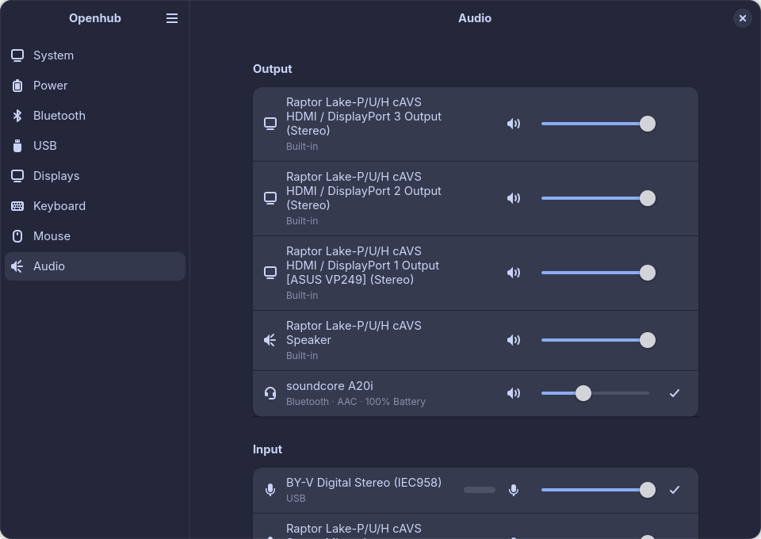

# Openhub

A lightweight GTK app that manages all connected devices, built with GTK4 + libadwaita in Rust. It covers Bluetooth, USB, power, mice, keyboards and audio.



## Status

[v0.4.1](https://github.com/CJTS15/openhub/releases/tag/v0.4.1) is the latest release.

- **Bluetooth** (since v0.1.0): turn the adapter on and off; connect and disconnect devices, with connected ones listed first; see battery levels; scan for and pair new devices through Openhub's own pairing agent; trust, block or forget devices.
- **USB** (since v0.2.0): a live list of USB devices, grouped under the hubs they're connected through, with built-in devices hidden behind a toggle; a details dialog for each device; safe eject for USB drives.
- **Power** (since v0.3.0): the laptop's battery and charging state, and every wireless device's battery, updated live; battery details with health and charge cycles; the "Preserve Battery Health" charge limit where supported; receiver batteries on the USB page.
- **Mouse** (new in v0.4.0): Logitech mice (DPI, SmartShift, scroll direction, restored when the mouse reconnects), Razer mice (DPI and polling rate, stored on the mouse), and other brands through ratbagd (DPI steps, report rate, buttons).
- **Keyboard** (new in v0.4.0): lighting and key remapping for VIA keyboards on their cable, from the keyboard's VIA definition; a Keyboard Shortcuts button for every keyboard.
- **Audio** (new in v0.4.0): default output and input, volume, mute, Bluetooth codec and a live microphone level; a 10-band equalizer per output with presets and AutoEQ import, which keeps working when Openhub is closed (PipeWire 1.4 or later).

## Installing

Download `openhub-0.4.1-x86_64.flatpak` from the [v0.4.1 release](https://github.com/CJTS15/openhub/releases/tag/v0.4.1). It needs the GNOME 50 runtime from Flathub:

```sh
flatpak install --user flathub org.gnome.Platform//50
flatpak install --user openhub-0.4.1-x86_64.flatpak
flatpak run io.github.cjts15.Openhub
```

### Mouse and keyboard access

Openhub talks to Logitech and Razer mice and to VIA keyboards directly, through `/dev/hidraw*`, which only root can open until a udev rule gives it to the logged-in user. A native install (`meson install` or a distribution package) puts the rules in place. The Flatpak carries them too, and they need copying once into the system, along with the user unit that restores Logitech mice's settings when they connect (they forget them when switched off). This works in any shell:

```sh
sh -c 'd="$(flatpak info --show-location io.github.cjts15.Openhub)/files/lib"; sudo cp "$d"/udev/rules.d/70-openhub-*.rules /etc/udev/rules.d/ && sudo udevadm control --reload && sudo udevadm trigger --action=add --subsystem-match=hidraw && mkdir -p ~/.config/systemd/user && cp "$d"/systemd/user/openhub-mouse@.service ~/.config/systemd/user/ && systemctl --user daemon-reload'
```

Run it again after updating Openhub, so the rules match the new version. From a source checkout, the same files are in `data/udev/` and `data/systemd/`.

The VIA and Razer rules list the devices tested so far, each limited to the one interface Openhub talks to. For another VIA keyboard, its dialog in Openhub shows the one-line rule to add. Mice of other brands need ratbagd (Piper's backend) installed.

### What the access means

- A udev rule lets **every program you run** open that device's raw HID interface, not only Openhub. On a keyboard's own interface that would let a program read keystrokes, so the VIA and Razer rules grant only the configuration interface. The Logitech rule is the same as [Solaar's](https://github.com/pwr-Solaar/Solaar): over Bluetooth, HID++ shares one interface with the device's input, so it covers Logitech keyboards' input too. Skip it if you don't use a Logitech mouse.
- The Flatpak asks for `--device=all`, because Flatpak has no narrower permission for `/dev/hidraw*`. Openhub only opens the HID devices it recognises.
- The equalizer writes `~/.config/wireplumber/wireplumber.conf.d/openhub-equalizer.conf`, which WirePlumber loads at login. Turning every equalizer off removes it.
- Openhub's Bluetooth pairing agent asks before confirming a pairing code, and refuses requests to authorize a device or service that it didn't start.

If blueman-applet is running, Openhub turns off its connection notifications, which can freeze GNOME Shell when many devices reconnect at once ([#4](https://github.com/CJTS15/openhub/issues/4)).

## Building

### Flatpak (recommended)

Requires `flatpak-builder` (from your distribution, or `flatpak install flathub org.flatpak.Builder` and run it as `flatpak run org.flatpak.Builder`) and the GNOME 50 SDK with the Rust extension:

```sh
flatpak install flathub org.gnome.Sdk//50 org.gnome.Platform//50 org.freedesktop.Sdk.Extension.rust-stable//25.08 org.freedesktop.Sdk.Extension.llvm21//25.08
flatpak-builder --user --install --force-clean _flatpak build-aux/io.github.cjts15.Openhub.json
flatpak run io.github.cjts15.Openhub
```

The manifest currently lets the build fetch crates over the network. Offline vendored sources are added before a Flathub submission.

### Native (Meson)

Needs GTK >= 4.14, libadwaita >= 1.5 (Ubuntu 24.04, Fedora 40, Debian 13 or newer), libpulse and libpipewire headers, libclang (for the PipeWire bindings), Meson, and a Rust toolchain. On Fedora: `gtk4-devel libadwaita-devel pulseaudio-libs-devel pipewire-devel clang-devel meson`; on Debian and Ubuntu: `libgtk-4-dev libadwaita-1-dev libpulse-dev libpipewire-0.3-dev libclang-dev meson`.

```sh
meson setup _build
meson compile -C _build
meson test -C _build
./_build/src/openhub
```

For quick iteration, `cargo run` also works.

## Architecture

- `src/application.rs`: `AdwApplication` subclass, app actions and shortcuts
- `src/window.rs` + `data/resources/ui/window.ui`: main window; the sidebar switches the content pane between categories
- `src/config.rs`: app ID and version, passed in by Meson
- `src/bluez/`: zbus proxies, the pairing agent and `BluetoothManager`, the only code that talks to BlueZ over D-Bus
- `src/model/`: `Adapter` and `Device` GObjects the UI binds to
- `src/ui/bluetooth/` + `data/resources/ui/bluetooth_page.ui`: the Bluetooth page, device rows, and the pairing and device details dialogs
- `src/usb/`: the sysfs scan, `usb.ids` names, `UsbManager`, and safe eject through UDisks2; the only code that reads or controls USB devices
- `src/model/usb_device.rs`: the `UsbDevice` GObject; a hub holds its children
- `src/ui/usb/` + `data/resources/ui/usb_page.ui`: the USB page
- `src/upower/`: UPower proxies, plain conversion rules, and `PowerManager`, the only code that talks to UPower
- `src/model/power_device.rs`: the `PowerDevice` GObject
- `src/ui/power/` + `data/resources/ui/power_page.ui`: the Power page
- `src/input/`: finds mice, touchpads and keyboards in `/sys/class/input`, one entry per physical device
- `src/audio/`: `AudioManager`, which lists audio outputs and inputs through libpulse (PipeWire serves it as `pipewire-pulse`)
- `src/ui/input/`, `src/ui/audio/`: the Mouse and Keyboard pages (one `InputPage` class) with their device dialogs, and the Audio page with its device and equalizer dialog
- `src/eq/`: the equalizer: a PipeWire filter graph set inside each output, and the WirePlumber rule that restores it
- `src/hidpp/`: Logitech's HID++ over hidraw, and the saved settings `openhub --apply-mice` restores
- `src/razer/`: Razer mice over hidraw feature reports
- `src/ratbag/`: ratbagd over D-Bus for other mice, with a fake ratbagd in its tests
- `src/via/`: VIA keyboards: the raw HID protocol, definition files and keycode names
- `src/battery.rs`: batteries the kernel or Razer report but UPower doesn't
- `data/udev/`, `data/systemd/`: the hidraw access rules and the mouse restore unit
- `src/ui/mod.rs`: `rescan_while_mapped`, the 2-second rescan the USB, Mouse and Keyboard pages share
- `src/watch.rs`: keeps a GObject in step with a cached D-Bus proxy's properties (shared by the BlueZ and UPower services)
- `tests/fixtures/sysfs-usb/`: a fake sysfs tree the USB parser tests run against
- `build-aux/test-upower.sh`: runs the UPower test against python-dbusmock (CI runs it too)

## License

GPL-3.0-or-later
